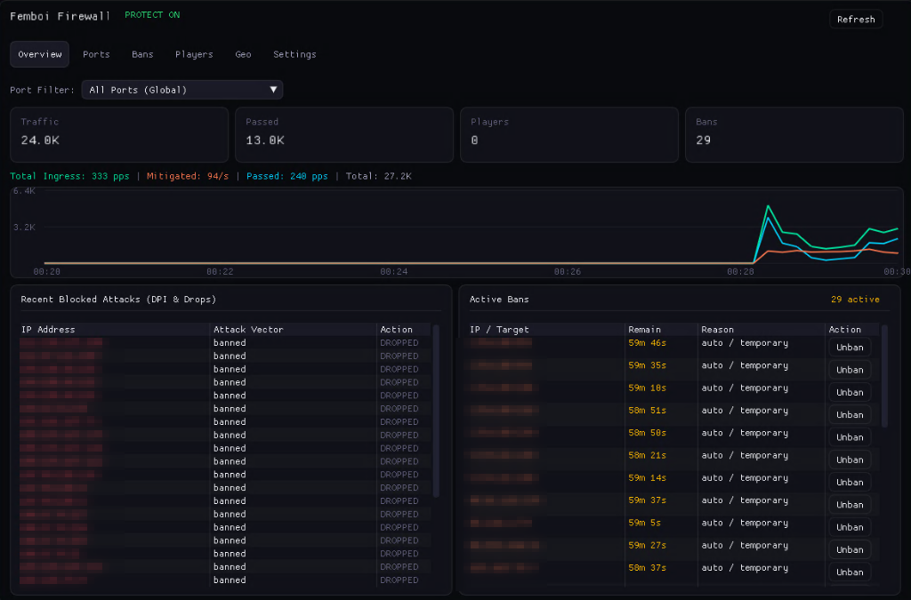
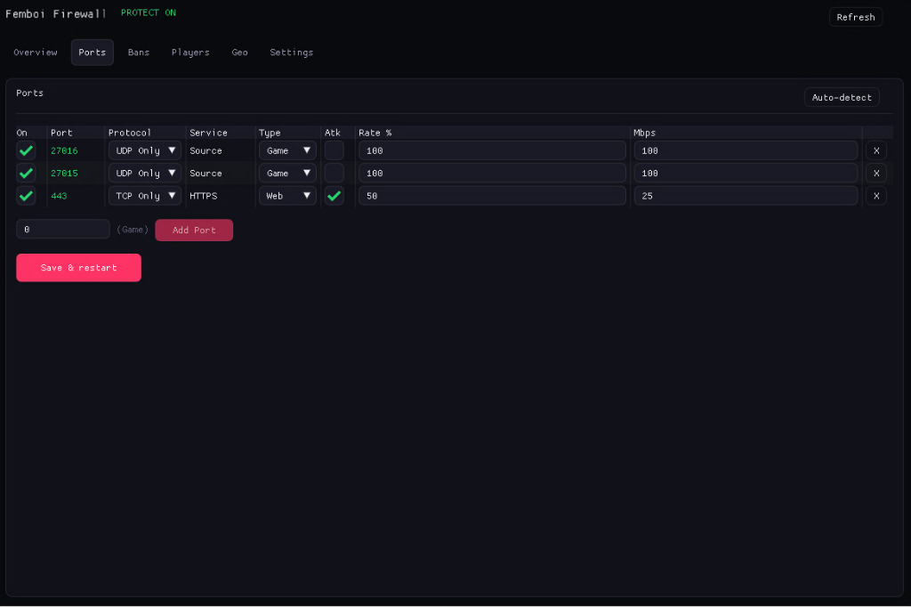
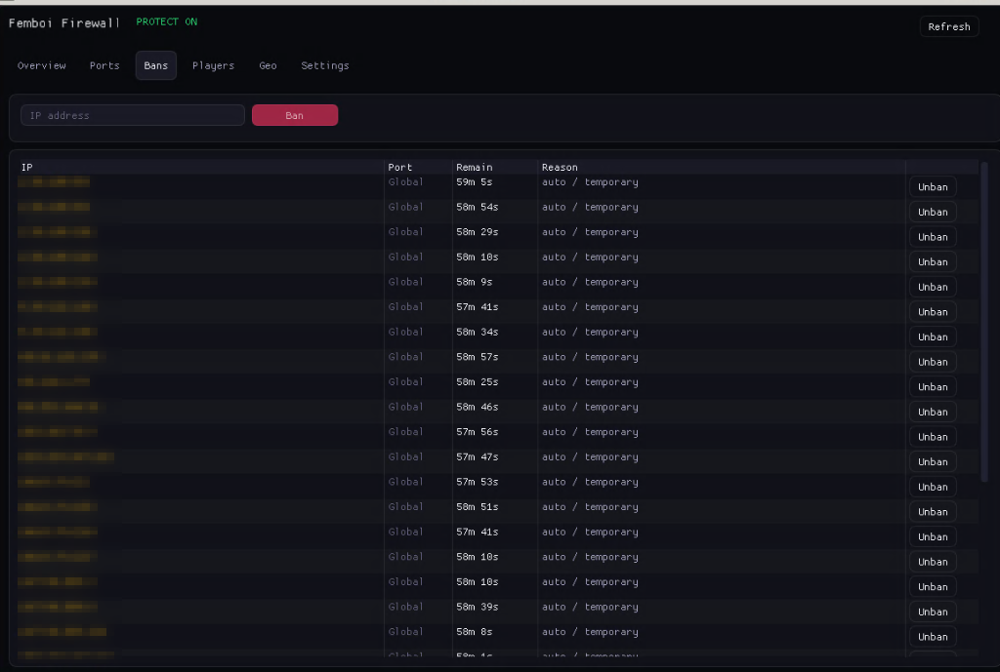
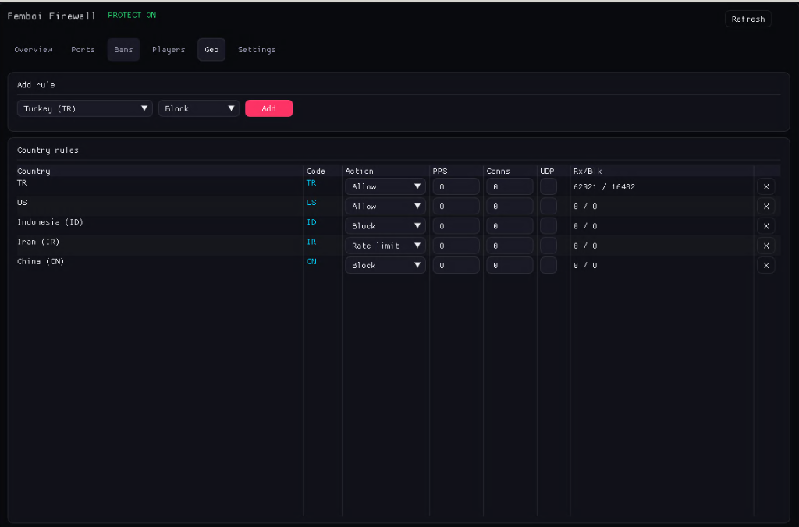
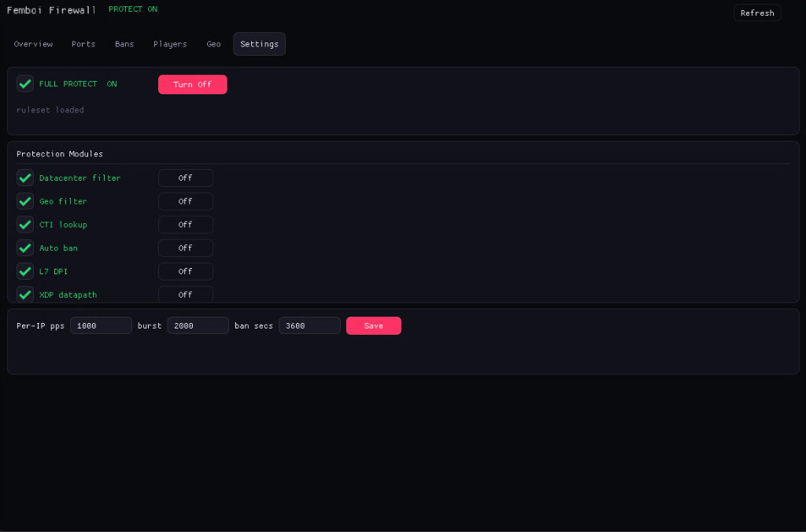

# femboi-firewall

Linux firewall for game servers (Source Engine, CS2, Rust) combining eBPF/XDP packet filtering, nftables rulesets, and an optional ImGui panel.

## Filtering Layers

- **XDP (eBPF)**: Early packet drops at the driver level before reaching the network stack.
- **nftables**: Rate limiting, dynamic IP bans, GeoIP filtering, and port rules.
- **L7 DPI (nfqueue)**: Inspection for game query floods (A2S_INFO) and malformed payloads.
- **ImGui GUI**: Optional desktop panel to monitor traffic and manage rules.

---

## Interface

<div align="center">

### Telemetry & Live Traffic
<sub>Real-time ingress bandwidth, mitigation rates, drop stats, and live attack logs.</sub>
<br><br>


<br><br>

### Port Quotas & Protocol Rules
<sub>Per-port bandwidth caps, UDP/TCP protocol separation, and rate limit budgets.</sub>
<br><br>


<br><br>

### Active Ban Sets
<sub>Dynamic blacklist decay timers and instant manual unbans.</sub>
<br><br>


<br><br>

### GeoIP Access Policies
<sub>In-memory binary trie country filtering (`geoip.dat`).</sub>
<br><br>


<br><br>

### Engine Settings & Modules
<sub>Runtime toggles for XDP datapath, L7 DPI, ASN filters, and burst thresholds.</sub>
<br><br>


</div>

---

## Architecture Overview

```
 NIC Ingress  ───►  [ Tier 1: XDP / eBPF Driver ]    L3/L4 Wire-Speed Drops
                          │ (XDP_PASS)
                          ▼
                    [ Tier 2: nftables Ruleset ]     Kernel Policy & GeoIP
                          │ (accept)
                          ▼
                    [ Tier 3: nfqueue L7 DPI ]       Game Protocol Verification
                          │ (clean stream)
                          ▼
                    [ Protected Application ]        srcds, cs2, nginx
```

| Ingress Layer | Subsystem | Latency | Main Responsibility |
|:---|:---|:---|:---|
| **Tier 1** | **XDP (eBPF)** | `< 1 µs` | High-volume flood drops before Linux network stack allocation. |
| **Tier 2** | **nftables** | Low | Stateful rate limits, per-port bandwidth budgets, ASN and country sets. |
| **Tier 3** | **nfqueue DPI** | Targeted | Steam A2S query validation, challenge enforcement, and exploit payload drops. |

---

## Features

- **XDP Driver Offload**: Drops malicious packets at driver level to prevent CPU exhaustion.
- **Source Engine Protocol Guard**: Validates `A2S_INFO` and challenge responses to mitigate reflection amplification.
- **Embedded GeoIP**: In-memory binary search over 200,000+ IP CIDRs (`geoip.dat`).
- **Datacenter / ASN Filter**: Rejects automated traffic originating from hosting and cloud IP ranges.
- **ImGui Desktop Control Panel**: Hardware-accelerated desktop interface for real-time monitoring and rule editing.
- **Zero Runtime Overhead**: Written in pure C++20 / C. No Python, Node.js, or Java runtime requirements.
- **Live Rule Reload**: Modify limits and unban addresses on-the-fly without dropping active connections.

---

## Installation & Quickstart

### 1. Install Dependencies (Debian / Ubuntu)

```bash
sudo apt update
sudo apt install -y build-essential nftables clang llvm libbpf-dev bpftool \
                    libgl1-mesa-dev libglfw3-dev libx11-dev linux-headers-$(uname -r)
```

### 2. Build & Install Daemon

```bash
git clone https://github.com/Flux-x/femboi-firewall.git
cd femboi-firewall

chmod +x derle.sh
./derle.sh
sudo ./derle.sh --install
```

### 3. Build Operator GUI (Optional)

```bash
make -C linux/gui
sudo cp linux/gui/fw-gui /usr/local/bin/fluxxfw-gui
```

### 4. Service Control

```bash
# Start and enable daemon
sudo systemctl enable --now femboi-firewall

# Check status
sudo systemctl status femboi-firewall
```

---

## Configuration Example

Configuration file: `/etc/femboi/firewall.conf`

**Flat `key=value` format — INI `[sections]` are not supported.** Unknown keys
are logged and ignored. The canonical example lives in
[`firewall.conf.example`](firewall.conf.example).

```ini
enabled=1

# port/proto (proto: tcp | udp | both)
ports=27016/udp,27015/udp,80/tcp,443/tcp

# Trusted sources: exempt from rate limits and auto-ban
whitelist=203.0.113.7,10.0.0.0/8

datacenter_filter=1
geo_enabled=1
auto_ban=1
ban_seconds=3600

per_ip_pps=1000
rate_burst=2000

dpi_enabled=0
dpi_queue=200

xdp_enabled=1
xdp_pin_dir=/sys/fs/bpf/femboifw

geoip_path=/usr/share/femboi/geoip.dat
rules_path=/etc/femboi/geo_rules.json
state_dir=/var/lib/femboi
```

Validate the generated ruleset before applying it:
```bash
sudo femboi-firewall ruleset | nft -c -f -
```

Reload ruleset without dropping active traffic:
```bash
sudo systemctl reload femboi-firewall
```

---

## CLI Management

```bash
# View daemon status and packet counters
femboi-firewall --status

# Inspect XDP eBPF map statistics
femboi-firewall-xdp stats

# View active nftables ruleset
sudo nft list table inet femboifw
```

---

## Windows Cross-Compilation

To cross-compile static Linux binaries from Windows:

```cmd
:: Requires zig in PATH
derle.bat
```

Output binaries are written to `bin/` (`femboi-firewall`, `femboi-firewall-xdp`).

---

## Limitations

- **Not a volumetric scrubber.** XDP/nftables mitigate application- and
  connection-layer floods on a single host. A line-saturating (Gbps) attack must
  be absorbed upstream by your provider's scrubbing/filtering — no on-box tool
  can help once the pipe is full.
- **IPv6 is currently passed, not filtered.** The ban/geo sets are IPv4 only;
  IPv6 (including ICMPv6 control traffic) is explicitly accepted so nothing is
  blackholed. Full IPv6 enforcement is on the roadmap.
- **Per-IP limits do not stop distributed floods.** They only constrain a single
  source; use them with, not instead of, upstream protection.

## Security

- Run the daemon as root only; it needs `CAP_NET_ADMIN`/`CAP_BPF`.
- `derle.sh --install` installs root-owned files; review it before running.
- Report issues via the repository's issue tracker.

## License

Distributed under the [MIT License](LICENSE).
